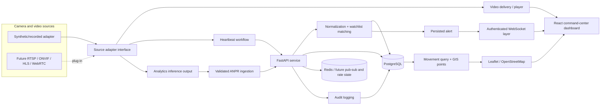
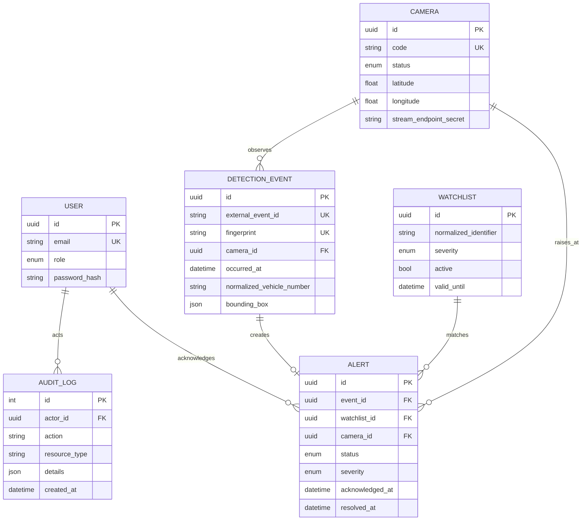

# Architecture

## System context

PostgreSQL is the source of truth. Event ingestion validates bounds/confidence/identity, normalizes the plate, checks exact external ID and a 10-second camera/plate fingerprint, persists, matches active valid watchlist rows, and commits before broadcasting. Response schemas deliberately omit `stream_endpoint_secret`.

## Entity model

Indexes support camera status/department/zone, plate/time, camera/time, active watchlist identifier, and alert status/time. Lists are bounded and relationship-heavy alert reads use joined loading.

## Adapter boundary

The prototype renderer consumes safe camera metadata and generates motion locally. Production adapters should expose capability metadata, health, a delivery reference, and normalized detections; secrets stay server-side. RTSP should terminate in an isolated media gateway producing HLS/WebRTC, never in the browser.

